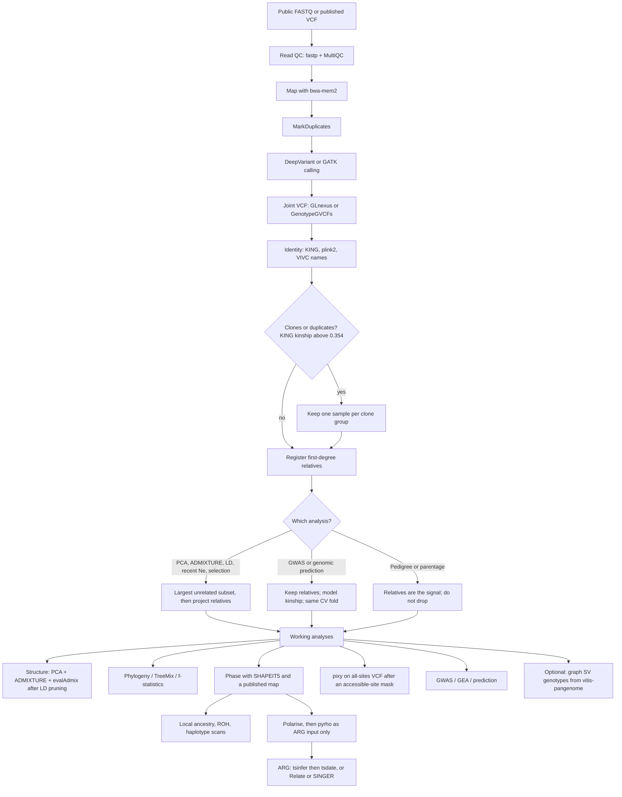

# Workflow - vitis-popgen

This page is the decision tree for the catalogue in `README.md`. It does not replace the AM03-AM26 modules in vitis-open-directions, and it does not replace grapeancestry.

## Default route

## Decision points

<!-- PROSE:WORKFLOW_DECISIONS -->
1. If the question concerns the 167K product, stop here and use grapeancestry.
2. If starting from FASTQ files, map reads with bwa-mem2, mark duplicates, and call variants. DeepVariant is the default caller and GATK is the alternative (AM03). If starting from a published VCF, document its origin and site definition (all-sites versus variants-only).
3. Always run KING and check names against VIVC before downstream analyses, separating two decisions. For clones or duplicates (KING kinship above 0.354, the duplicate or MZ class in the KING manual; Manichaikul et al. 2010, 10.1093/bioinformatics/btq559), retain one sample per clone group across all analyses; a technical-replicate IBS or genotype-discordance cutoff may be used to calibrate that threshold. For first-degree relatives (kinship 0.177 to 0.354; AM26 used 0.177 as the lower cutoff), record them rather than dropping them as identical genotypes.
4. Treatment of first-degree relatives depends on the analysis. For PCA, ADMIXTURE, LD, recent Ne, and selection scans, extract the largest unrelated subset and project the held-out relatives, or report a sensitivity analysis comparing the unrelated subset with the full sample; LD-prune before running ADMIXTURE and PCA. For GWAS and genomic prediction, retain relatives, model kinship explicitly, and keep relatives within the same cross-validation fold. For pedigree and parentage analyses, relatives are the primary signal and must not be removed.
5. Use a published linkage map for SHAPEIT5 whenever one can be interpolated onto the working reference; do not phase using a pyrho map (AM26). Before unfolded DFE, genetic load, or ARG analyses, polarise alleles with est-sfs using two or more outgroups and never *Muscadinia* alone. pyrho maps serve strictly as ARG input and are not used for local ancestry, ROH, or haplotype scans, which start directly from the phased VCF. Once alleles are polarised and a pyrho map is prepared, the ARG workflow proceeds via tsinfer followed by tsdate, or via Relate or SINGER.
6. For pi, dxy, and Fst, run pixy on an all-sites VCF filtered with an accessible-site mask rather than using variant-only vcftools windows.
7. Convert demographic estimates to years only under an explicit generation-time assumption. In a clonal crop, one generation corresponds to the interval between sexual generations, which is both long and uncertain. For ARG, SMC, and related methods, set a cultivar's sample time to its sexual origin rather than the year of DNA extraction. Because that origin date is usually unknown, treat it as a parameter or explore it via sensitivity analysis rather than fixing it as a known constant. Somatic mutations accumulated during clonal propagation have little effect on SMC, though they can produce a few overly long tip branches on an ARG. Hybrid-origin cultivars can also generate false old Ne peaks in PSMC and MSMC.
8. Graph and SV population genetics are handled in vitis-pangenome; this repository only links to it.
9. Ancient samples are processed through grapevine-adna first, then re-enter this workflow at projection, f-statistics, and clone matching.
<!-- /PROSE:WORKFLOW_DECISIONS -->

Versions of the named tools are in the main catalogue, checked on 2026-11-14, Asia/Shanghai (CST, UTC+8).
