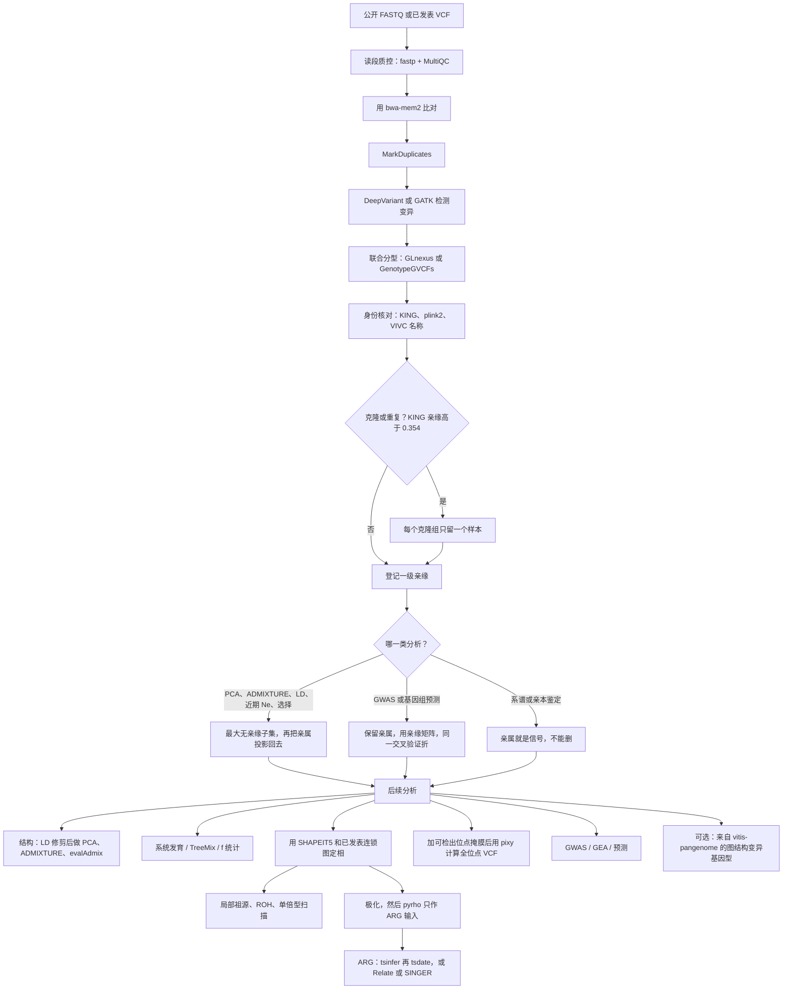

# 流程 - vitis-popgen

本页是 [`README.zh.md`](../README.zh.md) 目录的决策树。它不替代 vitis-open-directions 里的 AM03–AM26 模块，也不替代 grapeancestry。

## 默认路线

## 决策点

<!-- PROSE:WORKFLOW_DECISIONS -->
1. 若研究问题针对 167K 产品，请止步于此，直接改用 grapeancestry。
2. 若从 FASTQ 原始数据起步，先用 bwa-mem2 进行序列比对，标记重复序列后检测变异。默认变异检测工具为 DeepVariant，备选为 GATK（AM03）。若已有发表的 VCF，需记录其数据来源及位点定义（全位点或仅变异位点）。
3. 开展任何下游分析前，必须先运行 KING 并对照 VIVC 核对名称，同时拆分以下两项决策。克隆或重复样本：KING 亲缘系数高于 0.354（即 KING 手册中的重复或同卵双生级别；Manichaikul 等 2010，10.1093/bioinformatics/btq559），在所有分析中每个克隆组仅保留一个样本，且可利用技术重复的 IBS 或基因型不一致率阈值来校准该界限。一级亲缘：亲缘系数介于 0.177 至 0.354 之间（AM26 采用 0.177 作为下限），需将其登记在案，不要当成同一个基因型删掉。
4. 一级亲缘的处理方式取决于具体分析目标。进行 PCA、ADMIXTURE、LD、近期 Ne 及选择扫描时，提取样本量最大的无亲缘子集，再将剔除的亲属投影回去，或同时报告无亲缘子集与全样本集的敏感性分析结果（运行 ADMIXTURE 和 PCA 前需先做 LD 修剪）。进行 GWAS 和基因组预测时，保留亲属样本，在模型中纳入亲缘关系矩阵，并在交叉验证时将亲属分入同一折。进行系谱重建和亲本鉴定时，亲属正是要找的信号，不能删。
5. 只要能将已发表的连锁图插值到工作参考基因组上，SHAPEIT5 定相即采用该连锁图，切勿使用 pyrho 遗传图进行定相（AM26）。在进行未折叠 DFE、遗传负荷或 ARG 分析前，需先使用 est-sfs 对等位基因进行极化，外类群要两个或以上，绝不可单独使用圆叶葡萄。pyrho 遗传图仅作为 ARG 的输入，不用于局部祖源、ROH 或单倍型扫描（这些分析直接基于定相后的 VCF 开展）。完成极化并准备好 pyrho 遗传图后，ARG 分析路线可选用 tsinfer 接 tsdate，或 Relate 或 SINGER。
6. 计算 pi、dxy 和 Fst 时，应使用经过可检出位点掩膜过滤的全位点 VCF，在 pixy 中进行估算，而不要使用仅含变异位点的 vcftools 滑窗计算。
7. 将群体历史参数换算为年份时，必须明确给出世代时间假设。在克隆作物中，一个世代对应两次有性生殖之间的间隔，该周期通常较长且存在较大不确定性。对于 ARG、SMC 及同类方法，品种的样本时间应取有性起源时间，而非 DNA 提取年份。由于起源年代通常未知，应将其作为参数处理或开展敏感性分析，不可固定为已知常数。克隆繁殖期间积累的体细胞突变对 SMC 影响很小，但在 ARG 末端分支上可能表现为极少数过长的分支。此外，杂交起源品种在 PSMC 和 MSMC 中可能产生虚假的古老 Ne 峰。
8. 基于泛基因组图和结构变异的群体遗传学分析在 vitis-pangenome 中完成，本仓库只放指针。
9. 古代样本需先通过 grapevine-adna 流程处理，随后在样本投影、f 统计量和克隆匹配环节重新汇入本流程。
<!-- /PROSE:WORKFLOW_DECISIONS -->

所列工具的版本见主目录，核对日期为 2026-11-14，Asia/Shanghai（CST，UTC+8）。
